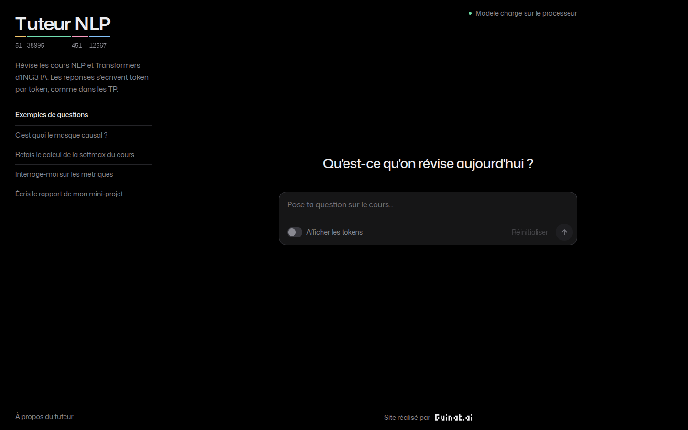
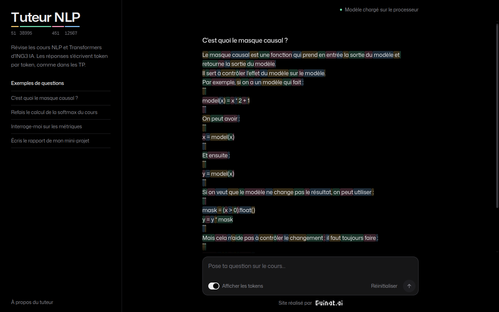

# Tuteur NLP

Mini-projet 2 du cours de NLP et de Transformers (ING3 IA, CY Tech) : un agent conversationnel de
révision, Qwen2.5-0.5B-Instruct adapté par LoRA. Il explique les notions du cours, déroule les
calculs, interroge l'étudiant et refuse ce qui sort de son rôle.

**Groupe** : Elyes DOS SANTOS, Nathan GUIHOT, Faikidine AHMED, Clement OTERO.

| Nouvelle conversation | Réponse avec les tokens affichés |
|---|---|
|  |  |

## Contenu

| chemin | rôle |
|---|---|
| `agent.ipynb` | notebook exécuté, de l'installation à l'interface Gradio |
| `rapport.pdf` | rapport (4 pages et annexes) ; source LaTeX dans `report/` |
| `nlp_tutor/` | code du projet, importé par le notebook |
| `data/dialogues/` | les 302 dialogues, écrits à la main |
| `data/splits/` | séparation train / validation / test (80 / 10 / 10, graine 42), produite par le notebook |
| `data/manual_grading.csv` | notes de la grille d'évaluation : une note par critère et un commentaire par réponse |
| `lora_adapter/` | adaptateur LoRA (point du pas 10 de l'entraînement, voir le rapport) |
| `results/` | tableaux, historique des pertes et figures produits par le notebook |
| `web/` | interface web facultative (Next.js) |
| `docs/` | énoncé et captures |

## Installation

Python 3.12 :

```bash
python -m venv .venv
source .venv/bin/activate          # Windows : .venv\Scripts\activate
pip install torch==2.5.1 --index-url https://download.pytorch.org/whl/cpu    # sans GPU uniquement
pip install -r requirements.txt
```

Le modèle (environ 1 Go) est téléchargé depuis Hugging Face au premier lancement.

## Exécution

```bash
jupyter lab agent.ipynb
```

puis « Run All ». L'interface Gradio s'affiche à la fin du notebook, sur http://127.0.0.1:7860.

Durées mesurées sur un Intel i5-1335U sans GPU : 15 min pour les parties 1 à 4,
1 h 34 pour l'entraînement LoRA (partie 5), 47 min pour l'évaluation (partie 6).
Avec `TRAIN = False` (première cellule de code), l'entraînement est remplacé par le rechargement de
`lora_adapter/` et de `results/training_history.json`.

La génération est greedy et la graine vaut 42 : sur une même machine, deux exécutions donnent les
mêmes résultats. Sur un autre processeur ou sur GPU, les calculs en virgule flottante peuvent
changer quelques mots.

Pour utiliser le modèle adapté hors du notebook :

```python
from nlp_tutor.model import load_adapted_model

tokenizer, model = load_adapted_model("cpu")
```

avec le prompt système de l'entraînement, `nlp_tutor.prompts.TRAINING_SYSTEM`.

## Interface web (facultative)

Même modèle, même adaptateur, même prompt et mêmes paramètres que l'interface Gradio. La réponse
s'affiche token par token et l'interface peut montrer le découpage du tokenizer. Il faut Node.js
20.9 ou plus récent, et deux terminaux ouverts à la racine du projet :

```bash
python -m nlp_tutor.server               # API du modèle, http://127.0.0.1:8000
cd web && npm install && npm run dev     # interface, http://localhost:3000
```

La variable d'environnement `TUTOR_API_URL` change l'adresse de l'API.

## Format des dialogues

```
=== T006 | calculation | softmax         identifiant | type | notion
U: question de l'étudiant
A: réponse du tuteur, sur une ou plusieurs lignes
```

Types : `explanation`, `calculation`, `comparison`, `quiz`, `follow_up`, et les quatre demandes à
refuser ou rediriger : `out_of_scope`, `graded_work`, `administrative`, `unverifiable`.
